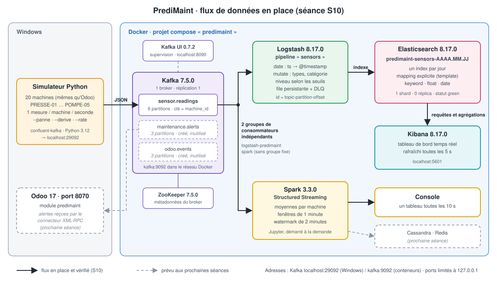

# Architecture Big Data PrediMaint : flux actuel (séance S10)

Mini-projet *Big Data Frameworks & NoSQL* : « Étude et évaluation d'une architecture Big Data
pour la maintenance prédictive des équipements industriels ».

## Flux en place

*Traits pleins : flux en place et vérifié. Pointillés : prévu aux prochaines séances.*

Lecture du schéma, de gauche à droite :

1. **Simulateur → Kafka.** Sous Windows, le simulateur envoie chaque seconde une mesure JSON
   par machine sur `localhost:29092`, dans le topic `sensor.readings`. La clé `machine_id`
   envoie toujours une même machine dans la même partition, donc ses mesures restent dans l'ordre.
2. **Kafka → deux consommateurs.** Logstash et Spark lisent le même topic, chacun avec son
   propre groupe : l'un ne vole pas les messages de l'autre. Si l'un s'arrête, les messages
   l'attendent dans Kafka.
3. **Logstash → Elasticsearch.** Le pipeline `sensors` convertit `ts` en `@timestamp`, force
   les types, ajoute la catégorie et le niveau (normal, surveillance, critique), puis indexe
   dans l'index du jour.
4. **Elasticsearch → Kibana.** Le tableau de bord interroge Elasticsearch toutes les 5 secondes.
5. **Spark → console.** Spark calcule les moyennes de chaque machine par fenêtre d'une minute.

Kafka UI sert à observer les topics, les partitions et le retard des consommateurs. ZooKeeper
conserve les métadonnées du broker. Les topics `maintenance.alerts` et `odoo.events` sont déjà
créés pour la suite : alertes de Spark vers Odoo, et événements d'Odoo vers la chaîne Big Data.

## Pourquoi chaque framework

| Composant | Rôle ici | Pourquoi ce choix |
| --- | --- | --- |
| **Simulateur Python** | Produit les mesures des 20 machines d'Odoo | Pas de matériel nécessaire. On contrôle les pannes (démo) et le débit (tests de performance). Client `confluent-kafka` (librdkafka en C) : rapide et fiable (`acks=all`, idempotence). |
| **Kafka** | Tampon d'ingestion entre les capteurs et tous les traitements | Les producteurs et les consommateurs sont découplés : si Logstash ou Spark s'arrête, les mesures restent dans Kafka et sont relues. Plusieurs consommateurs (Logstash, Spark) lisent le même flux, chacun dans son groupe. Les partitions répartissent la charge ; la clé `machine_id` garantit l'ordre des mesures d'une même machine. |
| **6 partitions** | Parallélisme de `sensor.readings` | Jusqu'à 6 consommateurs en parallèle dans un groupe (2 threads Logstash, 6 tâches Spark). 20 machines se répartissent sur 6 partitions. |
| **Réplication 1** | Provisoire | Un seul broker dans l'environnement du cours. Elle passera à 3 avec le cluster de 3 brokers (tests de tolérance aux pannes). |
| **Logstash** | Collecte, transformation, indexation | Framework ETL de la pile Elastic vu au Lab 2 : configuration déclarative input → filter → output. `date` convertit `ts` en `@timestamp`, `mutate` force les types, une règle calcule le niveau (normal / surveillance / critique) à partir des seuils d'Odoo. |
| **File persistante** | Fiabilité de Logstash | Les événements lus dans Kafka sont écrits sur disque avant d'être traités : un arrêt de Logstash ou d'Elasticsearch ne les perd pas. |
| **`document_id` = topic-partition-offset** | Idempotence | Si Logstash relit des messages après une panne, il réécrit les mêmes documents au lieu de créer des doublons. |
| **Elasticsearch** | Recherche et agrégations sur les mesures | Index inversé et agrégations rapides (`avg`, `terms`, `date_histogram`) pour le tableau de bord. Un index par jour : suppression simple des anciennes données. Mapping explicite : les champs ont le bon type dès le premier document. Il ne compte pas parmi les deux bases NoSQL exigées (Cassandra et Redis, séance suivante). |
| **1 shard, 0 réplica** | Réglage de l'index | Un seul nœud : un réplica ne pourrait pas être placé (statut yellow). Un index journalier reste petit (environ 1,7 million de mesures par jour, quelques centaines de Mo) : un shard suffit. |
| **Kibana** | Tableau de bord temps réel | Visualisation directe des index Elasticsearch, rafraîchissement automatique toutes les 5 s pour la démo. |
| **Spark Structured Streaming** | Traitement continu (fenêtres d'une minute) | Moteur distribué vu en cours, avec la même API que le batch (DataFrame). Fenêtres temporelles sur le temps de l'événement, watermark pour les retards. Il calculera ensuite les anomalies et alimentera Cassandra, Redis et `maintenance.alerts`. |

## Adresses

| Service | Depuis Windows | Depuis un conteneur |
| --- | --- | --- |
| Kafka | `localhost:29092` | `kafka:9092` |
| Kafka UI | http://localhost:8090 | |
| Elasticsearch | http://localhost:9200 | `http://elasticsearch:9200` |
| Kibana | http://localhost:5601 | |
| Logstash (API de supervision) | http://localhost:9600 | |
| JupyterLab / Spark UI | http://localhost:8888 · http://localhost:4040 | |
| Odoo 17 (hors Docker) | http://localhost:8070 | |

## Prochaines étapes

Cassandra (mesures et agrégats), Redis (dernières valeurs, seuils, alertes actives), détection
d'anomalies dans Spark et publication dans `maintenance.alerts`, connecteur vers Odoo
(`predimaint.alert.create_from_api`), pipeline Logstash `alerts`, 3 brokers Kafka.
